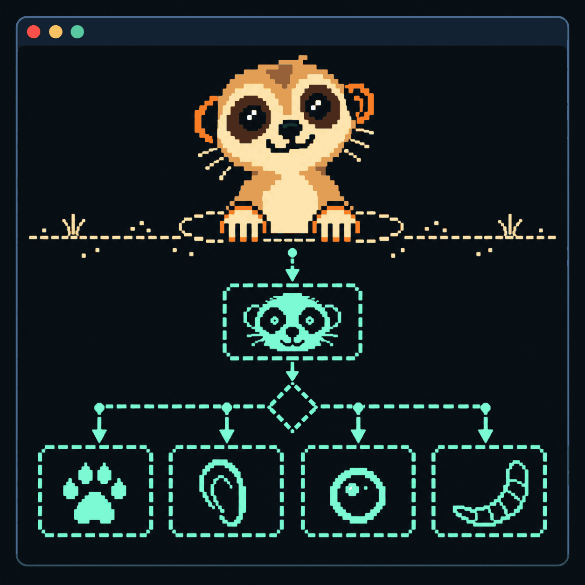
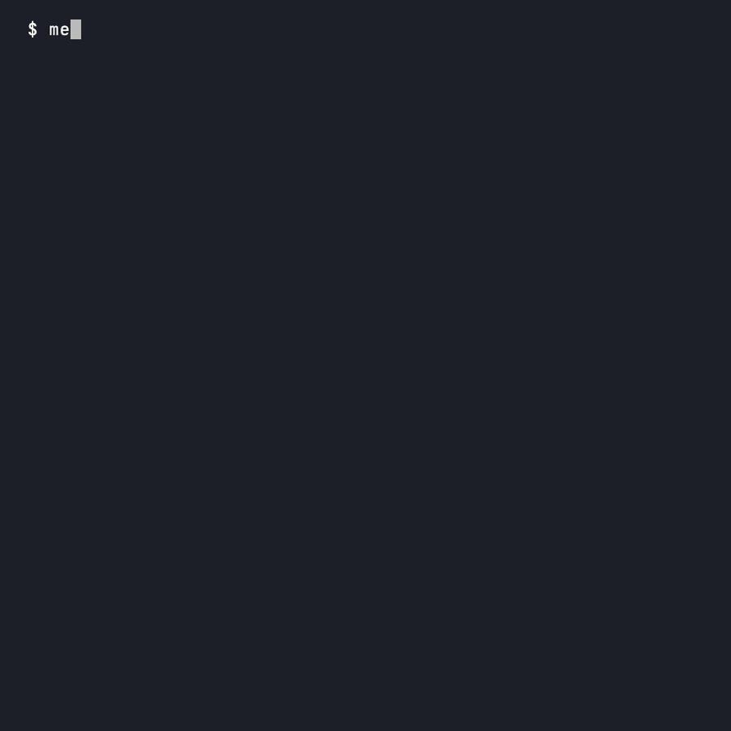

# mercat — mermaid diagrams, drawn in your terminal

`cat` for markdown, with mermaids. Flowcharts drawn as text that fits your terminal width; also a markdown viewer. Written in Zig.

<p align="center">
  
</p>

[](https://github.com/tawago/mercat/actions/workflows/ci.yml)
[](https://github.com/tawago/mercat/releases)
[](LICENSE)

## Installation

### Homebrew

```bash
brew install tawago/tap/mercat
```

Works on both macOS and Linux.

### Debian/Ubuntu and Fedora/RHEL

`.deb` and `.rpm` packages are attached to each
[release](https://github.com/tawago/mercat/releases):

```bash
sudo apt install ./mercat_<version>_amd64.deb   # Debian/Ubuntu
sudo dnf install ./mercat-<version>.x86_64.rpm  # Fedora/RHEL
```

### Installer Script

```bash
curl -fsSL https://raw.githubusercontent.com/tawago/mercat/main/install.sh | bash
```

### Direct Download

Release archives are published at:

`https://github.com/tawago/mercat/releases`

### Build From Source

Requires Zig 0.17.0+.

```bash
zig build -Doptimize=ReleaseFast
# Binary at ./zig-out/bin/mercat
```

### Claude Code Plugin

Draws the mermaid diagrams in Claude's replies with mercat. Needs `mercat`
on your `PATH`. At the prompt of a Claude Code session:

```
/plugin install mercat --marketplace tawago/mercat
```

See [`mods/mercat/README.md`](mods/mercat/README.md) for more.

## Features

<p align="center">
  
</p>

- **CLI mode**: Render markdown with syntax highlighting to stdout
- **TUI mode**: Interactive pager with vim-style navigation
- **Editor integration**: Press `e` to edit in `$VISUAL`/`$EDITOR` (or the configured editor), auto-reloads on return
- **Themes**: Seven built-in presets (`dark`, `light`, `ansi`, `dracula`, `tokyo-night`, `pink`, `markview`) plus user theme files with per-slot color and glyph control
- **Pager support**: Pipe through $PAGER or `less -R`
- **Stdin support**: `cat file.md | mercat` (implicit; `-` still works)
- **Bare Mermaid**: pipe raw diagram source with no ```` ```mermaid ```` fence
- **GFM support**: Tables, task lists, fenced code blocks, strikethrough

## Usage

```bash
mercat README.md                 # print to the terminal
mercat -t README.md              # open in the TUI
mercat -p README.md              # open in your pager
cat notes.md | mercat            # read from a pipe
mercat flow.mmd                  # a bare mermaid file
mercat --theme dracula README.md
mercat --format png -o doc.png README.md
```

`mercat --help` lists every option.

Piped input with no markdown around it is drawn as one diagram when its first
line starts with a diagram keyword, such as `flowchart TD` or `sequenceDiagram`.

Color is on only when the output is a terminal. Use `--color always` to keep it
through a pipe, or set `NO_COLOR` to turn it off.

mercat exits with `0` on success, `1` when something fails at runtime, and `2`
on a bad command line.

## TUI Key Bindings

| Key | Action |
|-----|--------|
| `j` / `↓` / `Ctrl-E` / `Ctrl-N` | Line down |
| `k` / `↑` / `Ctrl-Y` / `Ctrl-P` | Line up |
| `Space` / `f` / `PgDn` / `Ctrl-F` | Page down |
| `b` / `PgUp` / `Ctrl-B` | Page up |
| `d` / `Ctrl-D`, `u` / `Ctrl-U` | Half page down / up |
| `g` / `Home` / `<` | Go to top |
| `G` / `End` / `>` | Go to bottom |
| `Enter` | Follow footnote link |
| `/` | Search (`Enter` confirms, `Esc` cancels) |
| `n` / `N` | Next / previous match |
| `Esc` | Clear the selection, then the search highlights |
| `e` | Edit the file, then reload |
| `r` | Reload file |
| `m` | Toggle front-matter metadata panel |
| `B` | Toggle subgraph edges (bridge/cross) |
| mouse drag | Select and copy text |
| `?` / `F1` | Toggle help |
| `Ctrl-Z` | Suspend (`fg` to resume) |
| `q` / `Ctrl-C` | Quit |

Drag with the mouse to select text. mercat copies it when you let go.

The TUI needs a real terminal for both input and output. With no file, `-t`
opens `./README.md`.

In a terminal that never answers a status query (`ESC [5n`), quitting or
pressing `e` can hang. See [#87](https://github.com/tawago/mercat/issues/87).

## Configuration

mercat reads `~/.config/mercat/config.toml`, or the same path under
`$XDG_CONFIG_HOME`. Every key is optional. Flags beat environment variables,
which beat the file. A bad line only prints a warning.

```toml
[general]
editor = ""          # empty means $VISUAL, $EDITOR, then nvim/vim/vi/nano
pager = "less -R"

[display]
theme = "dark"
width = 0            # 0 is the terminal width
heading_markers = true
color = "auto"       # auto, always, never
frontmatter = "panel" # panel, dim, compact, raw, hidden

[mermaid]
subgraph_edges = "bridge"  # bridge or cross
```

### Themes

The built-in themes are `dark`, `light`, `ansi`, `dracula`, `tokyo-night`,
`pink` and `markview`. Pick one with `--theme`, `MERCAT_THEME` or `theme` in
the config.

You can change any part of a theme in the config:

```toml
[theme.heading1]
fg = 81
bold = true

[theme.glyphs]
bullets = ["•", "◦", "‣"]
table_style = "rounded"   # grid, heavy, double, ascii, rounded
```

To make your own theme, start from a built-in one:

```bash
mercat --dump-theme dark > ~/.config/mercat/themes/mine.toml
mercat --theme mine README.md
```

[`theme-guide.md`](theme-guide.md) lists every part you can style. Open it
with mercat to see each one change.

## Development

```bash
zig build
zig build test
```

## License

mercat is licensed under [GPL-3.0-or-later](LICENSE).

Want to build mercat into closed-source software? A commercial license is
available. AI labs: if you want to train models on mercat's output, or
acquire mercat outright, please get in touch. See
[`LICENSING.md`](LICENSING.md).
