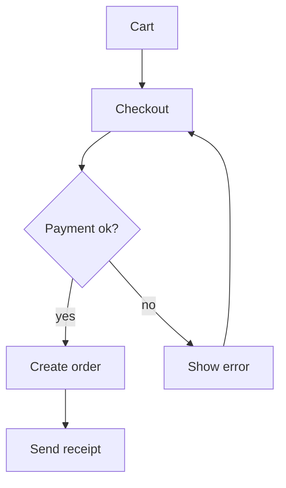

# tinyshop

A small web shop that runs on one server.

## Quick start

- Install Zig 0.17 or newer
- Copy `config.example.toml` to `config.toml`
- Run the dev server:

```bash
zig build run -- --port 8080
```

## Services

| Service  | Port | Owner    |
|----------|------|----------|
| web      | 8080 | frontend |
| api      | 9000 | backend  |
| worker   | -    | backend  |

## Checkout flow



## Release

1. Bump the version in `build.zig.zon`
2. Tag and push:

```bash
git tag v1.2.0 && git push --tags
```

- CI builds the binaries
- The worker restarts on deploy
